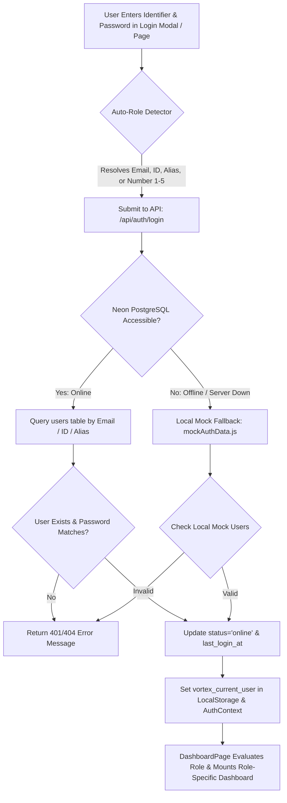

# Technical Architecture & Multi-User Login System Report

---

## 1. Executive Summary

**Vortex Cyber Defense** is a multi-tenant B2B cybersecurity commerce and operations platform. It features a two-sided architecture:
1. **Platform Owner Layer (Vortex Team)**: Manages sovereign cybersecurity tooling, platform infrastructure, product catalogs, and client subscriptions.
2. **Customer Organization Tenant Layer (Client Companies)**: Organizations (e.g., Apex CyberTech, Nexus FinSecure) purchase security products, manage internal teams, triage vulnerabilities, and enforce organizational security posture.

---

## 2. Complete Technology Stack ("Tech Things Used")

### Frontend Stack
* **Framework:** **React 19** (`react`, `react-dom`) — Utilizing modern hooks, contextual state, and functional component trees.
* **Build Tool & Dev Server:** **Vite 6** (`vite`, `@vitejs/plugin-react`) — Ultra-fast HMR and ESM bundling.
* **Styling & Design System:**
  * **Tailwind CSS v4** (`tailwindcss`, `@tailwindcss/vite`) — Custom dark-cyber theme, glassmorphism, glowing cyan/purple accent palettes.
  * **Custom CSS / Canvas:** Dynamic gaze tracking hero (interpolated cursor tracking via HTML5 `<video>`/`<canvas>`).
* **Animation & Micro-Interactions:**
  * **Framer Motion (`framer-motion` v13)** — Powers the 3D Radial Rosette Card Deck (physics-based toss/momentum rotation) and smooth modal transitions.
* **Icons:** **Lucide React** (`lucide-react`) — High-precision SVG iconography for cybersecurity telemetry and controls.
* **State Management:** **React Context API** (`AuthContext.jsx`, `StoreContext.jsx`, `ThemeContext.jsx`) backed by `localStorage` persistence.

### Backend & API Stack
* **Runtime:** **Node.js** (Native ES Modules `type: "module"`).
* **Web Framework:** **Express.js v5** (`express`) — REST API handling `/api/auth/*`, `/api/users`, `/api/companies`, `/api/orders`, `/api/products`, etc.
* **Middleware:**
  * `cors` — Cross-Origin Resource Sharing handling frontend requests.
  * `dotenv` — Environment configuration management.
  * Native Node `crypto` — Secure prefix generation, key hashing, and telemetry IDs.
* **Process Concurrency:** `concurrently` — Orchestrates simultaneous execution of client (`vite`) and backend API (`node server/server.js`).

### Database & Cloud Storage
* **Database:** **Neon Serverless PostgreSQL** (`@neondatabase/serverless`).
* **Connection Protocol:** TLS 1.3 / HTTPS over WebSocket (`ws`) via port 443, eliminating corporate firewall blocks on typical port 5432.
* **Database Driver:** `pg` (node-postgres) and Neon HTTP/WebSocket SQL client (`server/db.js`).
* **Data Model:** Normalized relational schema with strict Foreign Keys, JSONB metadata, automated timestamp triggers (`plpgsql`), and unique constraints.

### Payment Gateway & Checkout
* **Payment Gateway SDK:** **Razorpay** (`razorpay` Node SDK + `src/utils/razorpay.js` frontend script integration).
* **Payment Modes:** Online (Cards, UPI, NetBanking) and Enterprise B2B Offline (Purchase Order / PO Invoice / Direct Wire Transfer).

---

## 3. Architecture of the Login & Authentication System

The platform implements a **Hybrid Multi-Tenant RBAC (Role-Based Access Control) System**:



### Key Login Features
1. **Intelligent Input Detection (`detectRoleFromInput`)**:
   Users can authenticate using:
   * **Corporate Email** (e.g., `sarah.admin@vortex.internal`, `arjun.mgr@quantumshield.in`)
   * **Role Shortcuts / Aliases** (e.g., `owner`, `adminmgr`, `seniormgr`, `companydev`, `employee`, `superdev`)
   * **Quick Number Identifiers** (`1`, `2`, `3`, `4`, `5`)
2. **Dual-Layer Resilience (Neon DB + Instant Fallback)**:
   * Attempts live authentication against Neon PostgreSQL database.
   * If the network drops or the backend is offline, it seamlessly falls back to local data (`mockAuthData.js`), preventing downtime during client demonstrations.
3. **Session Persistence**:
   * Synchronized with browser `localStorage` (`vortex_current_user`, `vortex_api_keys`, `vortex_vulns`).
   * Provides single-click user switching and instant session revocation.

---

## 4. Working of the Login System for Different User Roles

The platform provides 5 distinct personas. Each persona has dedicated access levels, data boundaries, and specialized dashboards:

```
[Platform Root]
 ├── 1. Super Developer (Platform Infrastructure)
 └── 2. Owner / Admin Manager (Platform Business Operations)
 
[Customer Organization Tenants]
 ├── 3. Senior / Company Manager (Organization Lead)
 ├── 4. Company Developer (Technical SecOps Lead)
 └── 5. Employee (Standard Organization Staff)
```

### Role 1: Super Developer (`super_developer` / `owner_tech`)
* **Role Objective:** System health, platform scalability, and infrastructure telemetry.
* **Credentials:** `alex.dev@vortex.internal` or `superdev` | Password: `password123` / `superdev123`
* **What Happens at Login:**
  * Authenticates with `LEVEL-5 ROOT` clearance.
  * Directs to **`SuperDevDashboard.jsx`**.
* **Capabilities & Views:**
  * Live hardware load monitors: CPU Load, RAM (e.g. 68.2% of 128 GB), Latency, Active WebSocket connections.
  * Real-time network throughput (Mbps In/Out) and node cluster health (32/32 healthy nodes).
  * System-wide action controls: Flush Redis cache, Toggle global Maintenance Mode.
  * Live streaming system logs (`NEON-PG`, `AUTH-GATEWAY`, `REDIS-FLUSH`).

---

### Role 2: Platform Owner & Admin Manager (`owner_manager` / `admin_manager`)
* **Role Objective:** Global business oversight, multi-tenant company control, product catalog management, and order processing.
* **Credentials:** `sarah.admin@vortex.internal` or `adminmgr` | Password: `admin123` / `password123`  
  *(Platform Owner: `owner@vortex.internal` | `owner123`)*
* **What Happens at Login:**
  * Validates against the **Singleton Owner Constraint** in PostgreSQL.
  * Directs to **`AdminManagerDashboard.jsx`**.
* **Capabilities & Views:**
  * **Tenant Management:** Oversee all client companies (Apex, Nexus, Quantum, ShieldHealth) and their allocated seat quotas.
  * **Cross-Tenant User Control:** Search and view all employees across all client companies, filter by online/idle status, and remotely revoke active sessions.
  * **Product Catalog (CRUD):** Create, update, or hide cybersecurity products, tiers, pricing, and license seat allocations.
  * **Order Governance:** Review client B2B checkout orders, verify cash/bank transfers, approve invoices, or revoke delinquent tenants.

---

### Role 3: Senior Manager / Company Manager (`company_manager` / `senior_manager`)
* **Role Objective:** Lead administrator for an individual client company tenant.
* **Credentials:** `marcus.mgr@apextech.com` or `seniormgr` | Password: `password123` / `manager123`
* **What Happens at Login:**
  * Authenticates and scopes queries strictly to their `company_id` (e.g., `comp-apex`).
  * Directs to **`SeniorManagerDashboard.jsx`**.
* **Capabilities & Views:**
  * **Internal Team Management:** View all employees and developers registered under their company.
  * **Product License Allocation:** Assign purchased cybersecurity product seats (e.g., VAPT, CSPM, SIEM) to specific internal developers or employees.
  * **Threat Monitoring & Logs:** Track real-time employee search queries, flagged security breaches, and compliance scores.
  * **Staff Provisioning:** Invite new staff members via email and assign designations.

---

### Role 4: Company Developer / SecOps (`company_developer` / `customer_dev`)
* **Role Objective:** Technical security execution, vulnerability remediation, and API security.
* **Credentials:** `david.dev@apextech.com` or `companydev` | Password: `password123` / `dev123`
* **What Happens at Login:**
  * Directs to **`CompanyDevDashboard.jsx`**.
* **Capabilities & Views:**
  * **API Key Management:** Generate and revoke production/staging telemetry ingest keys with granular scopes (`read:telemetry`, `write:events`).
  * **On-Demand Vulnerability Scanner:** Trigger live vulnerability scans against target domains/subdomains.
  * **CVE Triage:** Review vulnerability reports (e.g., SQL Injection, Missing Content-Security-Policy headers), severity ratings, and mark resolution status.

---

### Role 5: Employee (`employee` / `customer_employee`)
* **Role Objective:** Standard organizational staff compliance and awareness.
* **Credentials:** `sophia.emp@apextech.com` or `employee` | Password: `password123` / `employee123`
* **What Happens at Login:**
  * Scoped to end-user individual training view.
  * Directs to **`EmployeeDashboard.jsx`**.
* **Capabilities & Views:**
  * **Credential Security Suite:** Built-in cryptographic password generator with real-time entropy calculation and strength scoring.
  * **Phishing & Security Checklist:** Interactive checklist covering 2FA enrollment, device encryption, and suspicious link handling.
  * **Incident Reporting:** One-click alert dispatch to report suspicious phishing emails or unknown device access directly to Company Managers.

---

## 5. Security & Database Rules Implemented

1. **Singleton Owner Constraint (`server/database_schema.sql`):**
   ```sql
   CREATE UNIQUE INDEX IF NOT EXISTS idx_users_single_owner_manager 
   ON users (role) 
   WHERE role = 'owner_manager';
   ```
   *Guarantees at the database engine level that no more than one platform owner can ever exist.*
2. **Tenant Boundary Scoping:**
   * Customer Managers, Developers, and Employees are strictly bounded to their assigned `company_id`. They cannot view or manipulate data belonging to other companies.
3. **Dynamic Role Routing:**
   * The single route `/dashboard` in `DashboardPage.jsx` dynamically mounts the matching role view based on the authenticated session's clearance and role token, preventing unauthorized privilege escalation.

---

## 6. Quick Reference: Demo Accounts

| Role | Role Key | Test Identifier | Default Password | Clearance Level |
| :--- | :--- | :--- | :--- | :--- |
| **Super Developer** | `super_developer` | `superdev` / `1` | `password123` | Level-5 Root |
| **Admin Manager** | `admin_manager` | `adminmgr` / `2` | `password123` | Platform Operations |
| **Platform Owner** | `owner_manager` | `owner` | `owner123` | Level-0 Root |
| **Senior Manager** | `senior_manager` | `seniormgr` / `3` | `password123` | Company Executive |
| **Company Developer** | `company_developer` | `companydev` / `4` | `password123` | SecOps / Tech Lead |
| **Employee** | `employee` | `employee` / `5` | `password123` | Standard Staff |
