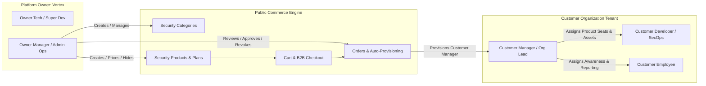
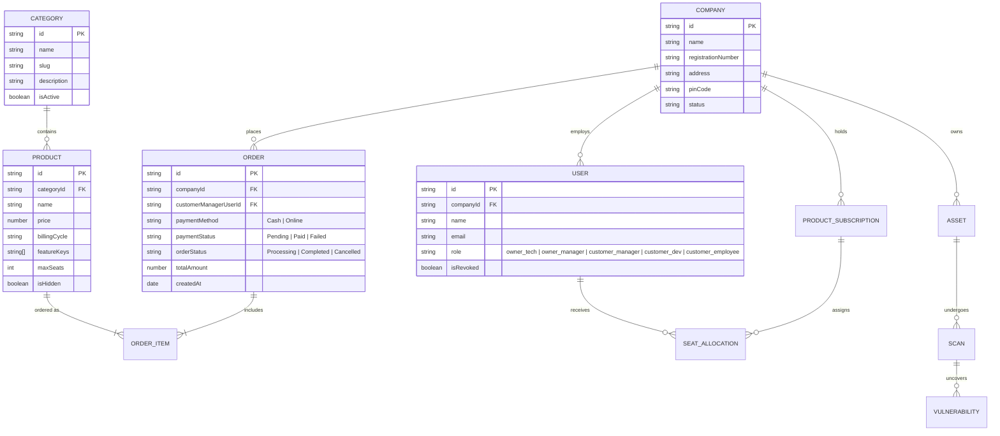
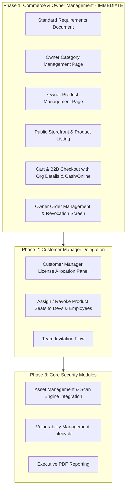

# Software Requirements Specification (SRS)
## Project: Vortex Multi-Tenant Cybersecurity Commerce & Management Platform

**Document Version:** 1.0.0  
**Status:** Approved Standard  
**Date:** October 2026  

---

## 1. Executive Summary & Core Concept

**Vortex Cybersecurity** is a hybrid **B2B Cybersecurity Marketplace and Enterprise Security Operations Platform**.
The platform operates under a **two-sided multi-tenant model**:
1. **Platform Owner (Vortex Team)**: Sells specialized cybersecurity tools, services, and modules to enterprise clients. Manages product catalogs, orders, customers, and platform infrastructure.
2. **Customer Organization (Client Company)**: Purchases security products/plans, delegates and assigns product licenses to internal teams (Engineers, Developers, Employees), monitors assets, scans, vulnerabilities, and incidents.

---

## 2. User Roles & Permission Matrix (5 Core Roles)

The platform has strictly defined boundaries across 2 Owner roles and 3 Customer roles:

| Role ID | Role Name | Entity | Primary Responsibilities |
| :--- | :--- | :--- | :--- |
| `owner_tech` | **Owner Tech (Super Dev)** | Platform Core | System health, worker nodes, scanner engines, API gateway, log infrastructure, platform telemetry. |
| `owner_manager` | **Owner Manager (Admin Ops)** | Platform Core | Product catalog (CRUD), category management, order approvals, pricing, revoking customer managers, audit logs. |
| `customer_manager` | **Customer Manager (Org Lead)** | Customer Org | Primary purchaser and account administrator. Manages company profile, purchases products, assigns/revokes product licenses to internal staff, invites devs/employees. |
| `customer_dev` | **Customer Developer** | Customer Org | Technical security tasks: scans assets, investigates code/API vulnerabilities, fixes issues, and marks remediation status. |
| `customer_employee`| **Customer Employee** | Customer Org | General organizational staff: security awareness trainings, compliance checklists, reporting suspicious phishing/threats. |

---

## 3. Functional Requirements

### 3.1 Storefront & Commerce Flow (Public & Registered)

1. **Security Categories Page & Sections**:
   * Hierarchical cybersecurity offerings:
     * *Vulnerability Assessment & Penetration Testing (VAPT)*
     * *Cloud Security Posture Management (CSPM)*
     * *Application & API Shielding*
     * *Continuous Threat & Endpoint Monitoring (SIEM/XDR)*
     * *Regulatory Compliance & Audit Readiness (ISO 27001, SOC 2, HIPAA)*
2. **Security Products Display**:
   * Each product contains: Name, Category, Badge (e.g., *Critical, Automated, Managed*), Short/Long Description, Tier/Pricing (Monthly/Annual), Features List, Included Seat Limits, Status (*Active, Hidden, Draft*).
3. **Cart & B2B Checkout**:
   * Add / Remove / Adjust security service plans in shopping cart.
   * **Mandatory B2B Registration & Billing Fields**:
     * Organization Name (e.g., `Apex CyberTech Corp`)
     * Company Registration No / Tax ID / GSTIN
     * Official Corporate Email & Contact Phone
     * Official Billing Address & PIN Code / Postal Code
     * Country & State / City
   * **Payment Methods Supported**:
     * **Cash / Bank Transfer / Purchase Order (PO Invoice)** (Pending Admin verification)
     * **Online Payment Gateway (Mock/Live Card/UPI/NetBanking)**

---

### 3.2 Owner Manager Backoffice (`/owner/dashboard` or Admin Mode)

1. **Category Management (`/owner/categories`)**:
   * Create new security categories with icons, slugs, and status.
   * Edit, enable, disable (hide from storefront), or delete empty categories.
2. **Product Management (`/owner/products`)**:
   * Create new cybersecurity tool/package with pricing, billing interval, license limit, and associated platform features (e.g., enables scanner, unlocks compliance tab).
   * Update details, toggle product visibility (*Active* vs *Hidden*), or archive product.
3. **Order Management (`/owner/orders`)**:
   * View paginated list of all customer orders.
   * Displays: Order ID, Timestamp, Customer Name, Org Name, Registration No, Billing Address & PIN, Purchased Products, Payment Method (Cash vs Online), Payment Status (*Paid, Pending, Failed*), Order Status (*Completed, Processing, Cancelled*).
   * Actions: Mark Cash Order as Paid, Cancel Order, Issue Refund/Revocation.
4. **Customer Company & Manager Oversight (`/owner/customers`)**:
   * View all active customer tenants and their assigned Managers.
   * **Kill Switch / Revoke Access**: Ability to suspend or revoke a customer manager’s account due to non-payment or compliance breach.

---

### 3.3 Customer Organization Portal (`/customer/dashboard`)

1. **Manager License & Product Allocation**:
   * View all active purchased security products.
   * **Assign Product / Seats**: Customer Manager selects a purchased product and assigns access to a `customer_dev` or `customer_employee`.
   * **Revoke Seat**: Customer Manager can detach a seat from an employee/developer and reallocate it.
2. **Team Member Management**:
   * Invite team members by email with role selector (`customer_dev` or `customer_employee`).
   * View list of members, their assigned tools, and access status.
3. **Operational Security Modules (Unlocked by Purchased Products)**:
   * **Assets**: Manage domains, APIs, and servers.
   * **Scans**: Trigger on-demand security scans on verified assets.
   * **Vulnerabilities**: Triage issues, assign to Developers, verify fixes.
   * **Alerts & Incidents**: Investigate suspicious events and manage containment timelines.
   * **Reports**: Download monthly executive security posture PDFs.

---

## 4. Data Models & Entity Relationships

---

## 5. Phased Implementation Roadmap

---

## 6. Acceptance Criteria for Phase 1

1. **Owner Manager Capabilities**:
   * Can create, edit, hide, and view categories.
   * Can create, price, describe, toggle visibility (*Active/Hidden*), and edit cybersecurity products.
   * Can view the complete Orders list showing Org Name, Registration Number, PIN Code, Address, Payment Mode (Cash/Online), and status.
   * Can revoke/suspend customer accounts if required.
2. **Customer / Public Capabilities**:
   * Storefront displays cybersecurity categories and visible products.
   * User can add products to cart and proceed to Checkout.
   * Checkout collects Organization Name, Registration No, Address, PIN code, and payment method (Cash / Online).
   * Completing checkout creates the order record, registers the customer as `customer_manager`, and displays the order receipt.
